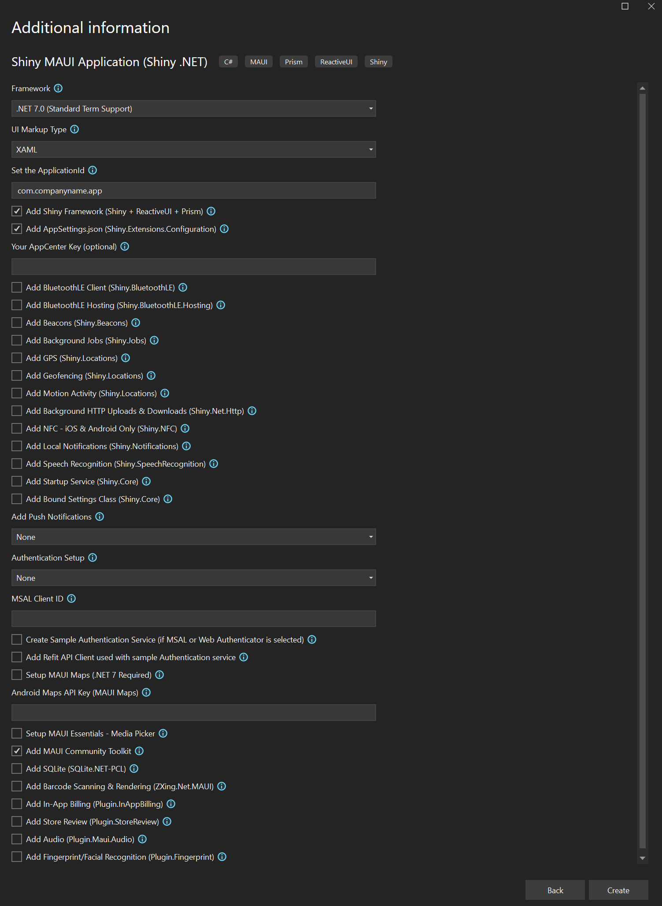

# Shiny Templates

Works with Visual Studio 2022 & JetBrains Rider 2024+

### To Install
> dotnet new install Shiny.Templates

---

## Features

### Project Templates

#### MAUI Shiny.NET App Project Template

* Supports Visual Studio for Windows 2022, Visual Studio for Mac 2022, & JetBrains Rider 2024+
* Creates all the necessary permissions, boilerplate, & setup you'll need to get your .NET MAUI app up and running with Shiny & many other great community libraries
* Easy setup and choice for push notifications
	* Full Native
	* Azure Notification Hubs
	* Firebase Cloud Messaging
* Creates a best practice MAUI application with best-in-class frameworks:
    * [.NET MAUI](https://learn.microsoft.com/en-us/dotnet/maui/what-is-maui)
	* [MVVM Community Toolkit](https://learn.microsoft.com/en-us/dotnet/communitytoolkit/mvvm)
	* [Shiny.NET](https://shinylib.net)
	* [Shiny Mediator](https://github.com/shinyorg/mediator)
	* [Shiny MAUI Shell](https://shinylib.net/client/maui)
	* [Shiny Extensions](https://shinylib.net/extensions)
	* [Shiny.Maui.Controls](https://shinylib.net/client/controls/)
	* [Shiny DocumentDb](https://github.com/shinyorg/documentdb) by Allan Ritchie

* Select mutliple platform UI Markup types
	* XAML
	* Blazor
* All The Shiny Libraries
	* [Shiny.Maui.Controls](https://shinylib.net/client/controls/) by Allan Ritchie — unified controls package (Scheduler, BottomSheet, ImageViewer, PillView, SecurityPin, Fab, and more)
	* [Shiny.Maui.Controls.Markdown](https://shinylib.net/client/controls/markdown/) by Allan Ritchie — native markdown renderer and editor (no WebView)
	* [Shiny.Maui.Controls.MermaidDiagrams](https://shinylib.net/client/controls/mermaid/) by Allan Ritchie — native Mermaid flowchart rendering (no WebView, AOT-safe)
	* [Shiny.Health](https://shinylib.net/client/health/) by Allan Ritchie — cross-platform health data access (HealthKit/Health Connect)
	* [Shiny.Music](https://shinylib.net/client/music/) by Allan Ritchie — unified music library & player API
	* [Shiny.Spatial.Geofencing](https://shinylib.net/client/spatial/) by Allan Ritchie — GPS-driven geofence monitoring with R*Tree spatial indexing
	* [.NET MAUI Community Toolkit](https://learn.microsoft.com/en-us/dotnet/communitytoolkit/maui/) Setup Including:
		* [Media Element](https://learn.microsoft.com/en-us/dotnet/communitytoolkit/maui/)
		* [Camera View](https://learn.microsoft.com/en-us/dotnet/communitytoolkit/maui/views/camera-view)
* Entitlements for iOS/MacCatalyst if necessary (ie. Push, MSAL)
* Info.plist & Entitlement permissions for iOS/MacCatalyst
* Helps generate Apple's "fun" PrivacyInfo.xcprivacy
* AndroidManifest.xml Permissions & Features for Android
* Preps all of the necessary functionality for a SQLite Database
* Setup proper localization	
* All of your MauiProgram.cs Dependency Injection
* Setup Logging Options with Local SQLite & Sentry.IO
* Create AppSettings.json
* Create & auto-configure a strongly-typed settings class that can be bound to preferences or secure storage using Shiny
* Create & auto-configure a Shiny startup service
* Setup Android Auto & iOS CarPlay
* Good practice setup for MSAL or Web Authenticator authentication service
	* Include a custom Refit HTTP client with authentication wired for best practices
* Setup everything needed for the .NET MAUI Essentials Media Capture service
* Mapping
	* Setup .NET MAUI Maps
	* Setup Google Maps
* Setup all of the necessary boilerplate for the following authentication providers:
	* MAUI Web Authentication
	* MSAL (Microsoft Authentication Library) Basic
	* MSAL (Microsoft Authentication Library) B2C
	* MSAL (Microsoft Authentication Library) Broker
* Full Setup for the following 3rd party components
	* [Prism](https://prismlibrary.com) by Brian Lagunas & Dan Siegel
	* [ReactiveUI](https://reactiveui.net) from many contributors
	* [MAUI Community Toolkit](https://github.com/CommunityToolkit/Maui) from many contributors
	* [MAUI Google Maps](https://github.com/themronion/Maui.GoogleMaps/tree/maui) by Pavlo Lukianets
	* [Refit](https://github.com/reactiveui/refit) by ReactiveUI Maintainers
	* [SQLite.NET-pcl](https://github.com/praeclarum/sqlite-net) by Frank Krueger
	* [RoomSharp](https://roomsharp.dev/) by Safwan Abdulghani
	* [Store Review Plugin](https://github.com/jamesmontemagno/StoreReviewPlugin) by James Montemagno
	* [MAUI Screen Recording Plugin](https://github.com/jfversluis/Plugin.Maui.ScreenRecording) by Gerald Versluis
	* [MAUI Audio Plugin](https://github.com/jfversluis/Plugin.Maui.Audio) by Gerald Versluis
	* [MAUI Calendar Store Plugin](https://github.com/jfversluis/Plugin.Maui.CalendarStore) by Gerald Versluis
	* [MAUI Screen Brightness Plugin](https://github.com/jfversluis/Plugin.Maui.ScreenBrightness) by Gerald Versluis
	* [MAUI Biometric Plugin](https://github.com/oscoreio/Maui.Biometric) by Konstantin S & Sven-Michael Stübe
	* [Embed.IO](https://unosquare.github.io/embedio/) by Unosquare
	* [Sentry](https://sentry.io) by Sentry
	* [SkiaSharp](https://github.com/mono/SkiaSharp) by Matthew Leibowitz
	* [SkiaSharp Extended (Lottie)](https://github.com/mono/SkiaSharp.Extended) by Matthew Leibowitz
	* [ACR User Dialogs](https://github.com/aritchie/userdialogs) by Allan Ritchie
	* [Debug Rainbows](https://github.com/sthewissen/Plugin.Maui.DebugRainbows) by Steven Thewissen
	* [Live Charts](https://livecharts.dev/) by Alberto Rodríguez
	* [System.Linq.Async](https://github.com/dotnet/reactive)
	* [Humanizer](https://github.com/Humanizr/Humanizer)
	* [Units .NET](https://github.com/angularsen/UnitsNet) by Andreas Gullberg Larsen
	* [Microsoft.Extensions.AI](https://learn.microsoft.com/en-us/dotnet/ai/ai-extensions) — unified AI service abstractions (IChatClient, IEmbeddingGenerator)
		* Blazor Libraries
		* [MudBlazor](https://mudblazor.com)
		* [Radzen Blazor](https://blazor.radzen.com/)
		* [Microsoft FluentUI](https://github.com/microsoft/fluentui-blazor)

#### Shiny.NET Server Extensions

* Minimal APIs
* Shiny Mediator Endpoint Setup
* .NET Orleans
* OpenAPI
* Entity Framework Basic Setup
* MSAL & WebAuthenticator Setup /w Google & Facebook
* Apple Domain Association Setup

### Item Templates
* Shiny BluetoothLE Hosted Managed Characteristic
* Shiny Job
